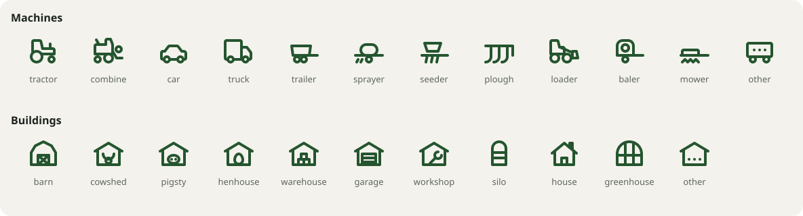

# Icons

Sierra uses [Lucide](https://lucide.dev) for UI icons. Asset types (machines and buildings) use a custom set drawn in [`apps/web/src/components/assetIcons.ts`](../apps/web/src/components/assetIcons.ts).

## 1. What the icons stand for

An audit of every icon in `apps/web/src`, grouped by meaning.

| Group | Icons (Lucide) → meaning | Consistent? |
|---|---|---|
| **Navigation** | `LayoutDashboard` dashboard · `ClipboardList` tickets · `Clock` work time · `Tractor` machines · `Building2` buildings · `StickyNote` notes · `Contact` contacts · `Users` team · `Bell` notifications · `Settings` settings · `Menu` more | Mostly. `Building2` is an office block, not a farm building. |
| **Machine types** | `Tractor` tractor · `Wheat` combine · `Car` car · `Truck` truck · `Container` trailer · `Droplets` sprayer · `Sprout` seeder · `Shovel` plough · `Forklift` loader · `Package` baler · `Scissors` mower · `Cog` other | **No.** See below. |
| **Building types** | `Warehouse` barn · `Beef` cowshed · `PiggyBank` pigsty · `Bird` henhouse · `Warehouse` warehouse · `Car` garage · `Wrench` workshop · `Cylinder` silo · `House` house · `Leaf` greenhouse · `Building2` other | **No.** See below. |
| **Ticket status** | `Circle` to do · `CircleDot` in progress · `CirclePause` blocked · `CircleCheck` done · `Ban` cancelled | Yes, all circles. |
| **Priority** | `ChevronDown` low · `Equal` normal · `ChevronUp` high · `ChevronsUp` urgent | Yes, a chevron scale. |
| **Due date** | `CalendarClock` due · `AlertTriangle` overdue | Yes. |
| **Roles** | `Crown` owner · `Shield` admin · `HardHat` employee | Yes. |
| **Day kind / leave** | `Briefcase` work · `TreePalm` vacation · `Thermometer` sick · `CalendarOff` absence notification | Yes. |
| **Notification types** | `UserPlus` assigned · `MessageSquare` comment · `AtSign` mention · `CircleDot` status · `CalendarOff` absence | Yes. |
| **Contact actions** | `Phone` call · `MessageSquare` SMS · `Mail` e-mail · `MapPin` map · `Globe` website | Yes. |
| **Ticket and asset details** | `Hand` take ticket · `Play` start/resume · `RotateCcw` reopen · `History` history · `ListChecks` checklist · `Camera` photos · `FileText` document · `Star` cover photo · `Gauge` hour/km meter · `Link2` link contact or invite · `Lock` private note or locked month · `Users` shared note · `Eye`/`EyeOff` visible to team | Yes. |
| **Generic UI** | `Plus` add · `Pencil` edit · `Trash2` delete · `X` close · `Check` confirm · `Search` · chevrons and arrows · `Download` · `Copy` · `Share2` · `SlidersHorizontal` filters · `List`/`Columns3` list/board · `Sun`/`Moon`/`Monitor` theme · `LogOut` · `Mic`/`MicOff` dictation · `Loader2` · `WifiOff` · `CircleAlert` · `ImagePlus` · `Send` · `Minus` | Yes, standard Lucide. |

### Problems with the old asset type icons

Each icon used a different metaphor:

- **The vehicle itself:** tractor, car, truck, loader (`Forklift`).
- **What it produces or handles:** combine → `Wheat`, seeder → `Sprout`, sprayer → `Droplets`, baler → `Package`.
- **A hand tool:** plough → `Shovel`, mower → `Scissors`, workshop → `Wrench`.
- **The animal, or a joke:** cowshed → `Beef` (a steak), henhouse → `Bird`, pigsty → `PiggyBank` (a money box).
- **Generic shapes:** trailer → `Container`, silo → `Cylinder`, greenhouse → `Leaf`, other → `Cog` / `Building2`.
- **Duplicates:** `Car` was used for both *car* and *garage*, and `Warehouse` for both *barn* and *warehouse*.

Because of this, machines did not look like machines and buildings did not look like buildings. A garage looked the same as a car, and a pigsty looked like a savings feature.

## 2. Groups

The custom set covers the two asset kinds from `assetTypes` in `@sierra/shared`:

| Family | Types |
|---|---|
| **Machines**, self-propelled | tractor, combine, car, truck, loader |
| **Machines**, towed implements | trailer, sprayer, seeder, plough, baler, mower |
| **Machines**, fallback | other |
| **Buildings**, farm buildings (shared shell) | cowshed, pigsty, henhouse, warehouse, garage, workshop, other |
| **Buildings**, own silhouette | barn, silo, house, greenhouse |

All other groups were already consistent, so they stay on Lucide.

## 3. Rules

**Shared with Lucide** (so custom and Lucide icons can sit side by side):
24×24 grid, 2px stroke, round caps and joins, no fill, `currentColor`, at least 1px padding.
The icons are built with `createLucideIcon`, so they take the same props as any Lucide icon (`size`, `strokeWidth`, `className`, …).

**Machines:** side view, facing right.

- Wheels come in three sizes and all stand on the same ground line (y = 20): small r=2, medium r=3, large r=4. Use the `wheel(cx, r)` helper.
- Self-propelled machines have a cab or body and their own wheels.
- Towed implements end in a drawbar to the right, at the same hitch point (22, 15), pointing towards the tractor that pulls them. Use the `hitch(fromX)` helper.
- Machines that work the soil (seeder, plough, mower) show their working parts touching the ground: coulters, mouldboards, the cutter bar. They have no wheels.
- **other** = a plain machine body on wheels with “…”.

**Buildings:** front view, standing on y = 20.

- Farm buildings share one gable roof (`roof`) and walls (`walls`). They differ only by an **emblem in the doorway**: cow head (cowshed), snout (pigsty), egg (henhouse), stacked boxes (warehouse), roller door (garage), wrench (workshop), “…” (other).
- Buildings with a unique shape use it instead: gambrel roof with an X‑braced door (barn), domed tower (silo), steep roof with a chimney and small door (house), glazed arch (greenhouse).

**Section icons:** `MachinesIcon` (tractor) and `BuildingsIcon` (barn) are used for navigation, quick add, tabs and empty states, so a section and its items look alike.

## Adding a type

1. Add the type to `assetTypes` in `packages/shared/src/enums.ts` and add translations.
2. Add its nodes to `machineIconNodes` / `buildingIconNodes`. TypeScript fails until every type has an icon. Follow the rules above and reuse the helpers.
3. Check it at 13, 17, 19, 24 and 56 px (56 px uses `strokeWidth={1.25}` on asset cards).
4. Regenerate the sheet: `npx tsx scripts/icon-sheet.ts`.
